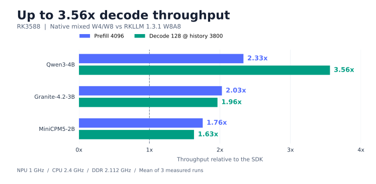

# RK3588：原生 Rust 推理与 RKLLM 1.3.1

Qwen3-4B 的 **pp4096 达到 SDK 的 2.33×**，**3800-token 历史下的 decode128 达到 3.56×**。128步 decode 计时从约 **55.40秒降到15.56秒**。Qwen3 C7-Rotate-QQQ 的 PPL 比 SDK W8A8 **低 2.64%**，MiniCPM5 **低 2.28%**。



单位为 token/s，表中给出3轮均值 ± 样本标准差；每项预热一次。倍率由未舍入的均值计算。性能为2026-10-14 板端实测，CPU4–7固定2.4 GHz、NPU1 GHz、DDR2.112 GHz；所有正式 Open 进程均零调优 miss，结束后恢复频率。

## Qwen3-4B

| 测试 | RKLLM 1.3.1 | Open | 吞吐倍率 | 吞吐提升 |
|---|---:|---:|---:|---:|
| pp512 | 105.037 ± 0.031 | 169.711 ± 0.127 | **1.62×** | +61.6% |
| pp1024 | 94.619 ± 0.021 | 157.033 ± 0.160 | **1.66×** | +66.0% |
| pp4096 | 50.133 ± 0.084 | 116.973 ± 0.050 | **2.33×** | +133.3% |
| decode128 @512 | 5.772 ± 0.002 | 10.497 ± 0.003 | **1.82×** | +81.8% |
| decode128 @1024 | 5.125 ± 0.004 | 10.090 ± 0.004 | **1.97×** | +96.9% |
| decode128 @3800 | 2.310 ± 0.005 | 8.226 ± 0.003 | **3.56×** | +256.0% |

## Granite-4.2-3B

| 测试 | RKLLM 1.3.1 | Open | 吞吐倍率 | 吞吐提升 |
|---|---:|---:|---:|---:|
| pp512 | 120.459 ± 0.107 | 182.476 ± 0.114 | **1.51×** | +51.5% |
| pp1024 | 106.277 ± 0.019 | 164.162 ± 0.240 | **1.54×** | +54.5% |
| pp4096 | 54.404 ± 0.004 | 110.307 ± 0.066 | **2.03×** | +102.8% |
| decode128 @512 | 6.806 ± 0.003 | 9.295 ± 0.012 | **1.37×** | +36.6% |
| decode128 @1024 | 6.370 ± 0.006 | 9.054 ± 0.004 | **1.42×** | +42.1% |
| decode128 @3800 | 3.932 ± 0.001 | 7.727 ± 0.003 | **1.96×** | +96.5% |

## MiniCPM5-2B

| 测试 | RKLLM 1.3.1 | Open | 吞吐倍率 | 吞吐提升 |
|---|---:|---:|---:|---:|
| pp512 | 211.052 ± 0.484 | 245.465 ± 0.279 | **1.16×** | +16.3% |
| pp1024 | 188.643 ± 0.082 | 219.865 ± 0.220 | **1.17×** | +16.6% |
| pp4096 | 98.874 ± 0.009 | 173.578 ± 0.034 | **1.76×** | +75.6% |
| decode128 @512 | 9.431 ± 0.006 | 13.151 ± 0.029 | **1.39×** | +39.4% |
| decode128 @1024 | 8.985 ± 0.003 | 12.954 ± 0.005 | **1.44×** | +44.2% |
| decode128 @3800 | 7.117 ± 0.003 | 11.613 ± 0.012 | **1.63×** | +63.2% |

## 前缀 PPL

| 模型 / Open PPL checkpoint | RKLLM W8A8 PPL | Open PPL | PPL 变化（越低越好） |
|---|---:|---:|---:|
| Qwen3-4B / C7-Rotate-QQQ | 12.8709 | 12.5317 | -2.64% |
| Granite-4.2-3B | 15.7448 | 16.0519 | +1.95% |
| MiniCPM5-2B | 14.1293 | 13.8073 | -2.28% |

三个模型各使用自己的 tokenizer；每个模型的 Open 与 SDK 逐目标 ID 均一致，共8160个目标。PPL 使用 WikiText-2 raw test 前32个连续、独立 c512 窗口，对零起始 target 位置257–511评分，每窗重置 KV，无 BOS/EOS 或 chat 模板。SDK NLL 已逐项检查 target ID，并重新汇总为表中 PPL；Qwen3 SDK PPL 来自2026-10-06 的同口径记录，其他两个 SDK PPL 为2026-10-14 实测。

## 测试配置

Open 性能配置使用 mixed W4/W8、W8 NPU lm_head、原生 FP16 GQA，context8192、chunk64、4 CPU线程、CPU mask `0xf0`、Linear NPU mask7。MiniCPM5 使用两核 Attention，其他两个模型使用三核 Attention。RKLLM 使用 W8A8 导出模型、Runtime1.3.1、driver0.9.8。

Qwen3 性能 checkpoint 为 `Qwen3-4B-W4A8-Mixed-LMHeadW8`，PPL checkpoint 为 `selection/models/C7-Rotate-QQQ`；两者结构与 W4/W8 模块分布相同。Granite 和 MiniCPM5 的性能/PPL 均对应各自 QQQ-SQ / QQQ-Rot 发布 checkpoint。

Open 输入为 `mt19937(42) % vocab_size` 固定 IDs，独立测量空 KV prefill 与带历史的128次单 token forward；历史建立在计时前完成。计时包含同步、KV、CPU 运算与输出头，排除加载、准备、采样和 HTTP。SDK 使用保存的语料前缀 IDs 与 greedy 生成，并采用 SDK phase timer。SDK 长 decode 的128步计时共回传129个 tokens，包含 prefill 的首个输出；两端比较128步 decode，初始历史均为3800。

## 限制

结果衡量这两套实际模型与运行时配置。量化权重、性能输入和计时边界按上述方法分别记录；吞吐倍率不单独归因于驱动。Qwen3 的速度来自前述性能 checkpoint。原生 NLL 使用 FP32 shifted exp 与 FP64 sum/log，SDK 使用 FP64 logsumexp；PPL 覆盖上述语料前缀。Granite 的 Open PPL 比 SDK 高1.95%，pp4096 吞吐为 SDK 的2.03倍。

## 证据与复现

全部样本、倍率、逐目标核验结果和新增3800-history原始测速及频率记录见 [sdk-comparison.json](evidence/sdk-comparison.json)。SDK 来源见 [rkllm-1.3.1-report.md](evidence/rkllm-1.3.1-report.md)，原生 PPL 配对值见 [model-ppl.json](evidence/model-ppl.json)。

在板上预备对应模型的 M32 bucket，再测长 decode。每个模型使用独立 cache；正式进程的 `stats.tune_cache_misses` 为0。

```sh
python3 scripts/run_board.py --wait-lock --report warm-clocks.json -- \
  target/release/open_rknpu2_lm_infer --model /path/to/performance-model --ctx-size 8192 \
  --tune-cache /path/to/model-cache bench --n-prompt 24 --n-gen 1 \
  --repetitions 1 --report warm.json
python3 scripts/run_board.py --wait-lock --report measured-clocks.json -- \
  target/release/open_rknpu2_lm_infer --model /path/to/performance-model --ctx-size 8192 \
  --tune-cache /path/to/model-cache bench --n-prompt 0 --n-gen 128 --n-depth 3800 \
  --repetitions 3 --report measured.json
```

C7 的32窗 PPL 使用其 tokenizer 从原始语料取得的32×512输入 IDs：

```sh
python3 scripts/run_board.py --wait-lock --report ppl-clocks.json -- \
  target/release/open_rknpu2_lm_infer --model /path/to/C7-Rotate-QQQ \
  --ctx-size 512 --ubatch-size 64 --no-tune ppl --tokens-file wiki32.json --report ppl32.json
```
